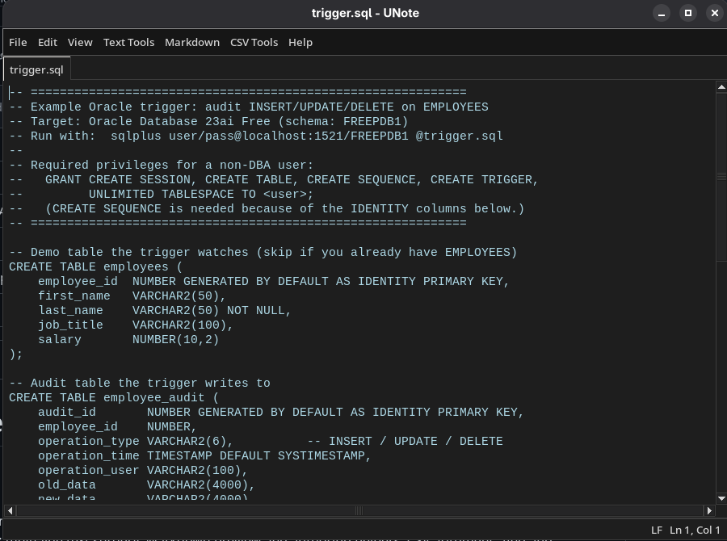

# UNote

A small, fast, multi-tab text editor for anything that is made of text.

UNote is one Python file with a tkinter window around it. It opens plain text,
Markdown, CSV, source code, config files and logs — anything you can read in a
terminal — in tabs, and gives you the tools that such files usually need:
multi-line text surgery, Markdown preview and authoring helpers, CSV arithmetic,
find and replace, printing, and a dark theme.

There is no framework, no build step, no server and no third-party dependency
on Linux or macOS. You run it, you edit, you close it.

To be clear about two different things that could both be called "one file":
the **application** is a single script (`unote.py`), while the **editor** is
multi-document — you can open any number of files at once, each in its own
tab, alongside untitled scratch tabs.

Written by: Theo Uys

### Repository

Source code: [github.com/theouys/unote](https://github.com/theouys/unote)

Bug reports, questions and pull requests are welcome — open an issue and
describe what you opened, what you expected, and what happened instead.

---

## Contents

- [Screenshots](#screenshots)
- [Features](#features)
- [Requirements](#requirements)
- [Installation](#installation)
- [Usage](#usage)
- [Keyboard shortcuts](#keyboard-shortcuts)
- [Text tools](#text-tools)
- [Markdown support](#markdown-support)
- [CSV tools](#csv-tools)
- [Printing](#printing)
- [Opening in VS Code and a terminal](#opening-in-vs-code-and-a-terminal)
- [Encodings and line endings](#encodings-and-line-endings)
- [Settings](#settings)
- [Troubleshooting](#troubleshooting)
- [Project layout](#project-layout)
- [License](#license)

---

## Screenshots

UNote's main window — the tab strip, the editing pane and the status bar:



---

## Features

**Editing**

- Tabbed editing — open as many files as you like, each in its own tab
- Untitled scratch tabs, so you can start writing without saving first
- Undo and redo, cut/copy/paste/select-all
- Find with live match count, match-case toggle, next/previous
- Find and replace, including replace-all
- Reload a tab from disk when the file changed underneath you (F5)
- Unsaved-changes marker in the tab label and window title, and a
  save/don't-save/cancel prompt before closing, printing, or handing the file off

**Fidelity** — UNote does not quietly rewrite your files:

- **Line endings are preserved.** A CRLF file stays CRLF, a CR file stays CR,
  and the status bar tells you which one you are editing
- **BOMs are honoured** on read (UTF-8 with BOM, and UTF-16)
- **Undecodable bytes are reported** rather than silently mangled
- Files are written in binary mode with an explicit line ending, so no newline
  translation happens behind your back

**Text tools** — add prefix/suffix to every line, extract a substring from every
line, trim each line, duplicate each line, insert a string at a position, remove
lines containing a string, keep only the selection, keep a line range, and
convert a selection to UPPER or lower case. All of them respect your selection,
or the whole file when nothing is selected.

**Markdown** — authoring shortcuts for bold, italic, strikethrough, inline code,
headings, lists, blockquotes, links, images, code blocks and horizontal rules,
plus a rendered preview in your real browser.

**CSV** — sum, average or count a column or a row, with a 1-based index and
optional header-row skipping.

**Printing** — native printer dialogue on Windows, CUPS queues on Linux, and a
browser print preview (which can save to PDF) as the universal fallback.

**Also** — light and dark themes that persist between runs, a status bar with
line ending and cursor position, and double-click-to-open support for text files
once installed as a desktop application.

---

## Requirements

### Python 3

Developed and tested on Python 3.14, and the code uses no language feature newer
than Python 3.6. Any reasonably modern Python 3 will do.

```bash
python3 --version
```

### tkinter

tkinter is part of the Python standard library, but many Linux distributions
ship it as a separate package. If `import tkinter` fails, install it:

```bash
# Debian / Ubuntu / Linux Mint
sudo apt install python3-tk

# Fedora / RHEL
sudo dnf install python3-tkinter

# Arch / Manjaro
sudo pacman -S tk

# openSUSE
sudo zypper install python3-tk
```

On macOS and Windows, the official installers from
[python.org](https://www.python.org/downloads/) include tkinter already. If you
use Homebrew's Python on macOS, you need `brew install python-tk`.

### Optional: pywin32 (Windows only)

Only needed for native printer selection and output on Windows. Without it,
printing falls back to the browser preview. Everything else works unchanged.

```bash
pip install pywin32
```

There are **no other dependencies**. Nothing to install from PyPI on Linux or
macOS.

### A graphical display

UNote is a desktop application. It needs X11 or Wayland (with XWayland). It will
not run over a bare SSH session, in a container without a display, or from cron.
It says so clearly instead of dumping a traceback.

---

## Installation

UNote is a single script — "installing" it is copying two files and, optionally,
making a launcher.

### Any platform

1. Download or clone the repository:

   ```bash
   git clone https://github.com/theouys/unote.git
   cd unote
   ```

2. Run it:

   ```bash
   python3 unote.py
   ```

That is the whole installation. `icon.png` is optional — it only sets the window
icon — but keep it beside `unote.py` if you want the icon to appear.

### Put it on your PATH (Linux / macOS)

```bash
mkdir -p ~/.local/bin
ln -s "$PWD/unote.py" ~/.local/bin/unote
chmod +x ~/.local/bin/unote
```

Make sure `~/.local/bin` is on your PATH, then `unote` works from anywhere.
The script starts with a shebang, so no `python3` prefix is needed.

### Desktop launcher (Linux)

To get UNote into your application grid and to make text files open in it on
double-click, create `~/.local/share/applications/unote.desktop`:

```ini
[Desktop Entry]
Type=Application
Name=UNote
Comment=Edit any text file
Exec=/home/YOURNAME/.local/bin/unote %F
Icon=/home/YOURNAME/Documents/develop/unote/icon.png
Terminal=false
Categories=Utility;TextEditor;
MimeType=text/plain;text/markdown;text/csv;
StartupWMClass=unote
```

Replace `YOURNAME` and the paths with your own. Then:

```bash
update-desktop-database ~/.local/share/applications
```

`StartupWMClass=unote` matches the window class the app sets for itself, which
is what lets the desktop associate the running window with the launcher icon.
Note that on GNOME/Wayland this association is unreliable, because XWayland
reparents the window and overwrites the class — a limitation of the platform,
not of UNote.

### Windows

1. Install Python from [python.org](https://www.python.org/downloads/) and tick
   **"Add python.exe to PATH"** during setup.
2. Double-click `unote.py`, or run `python unote.py` from a terminal.
3. Optionally `pip install pywin32` for native printing.

To associate text files with UNote, right-click a `.txt` file →
**Open with** → **Choose another app** → **More apps** → **Look for another
app**, and pick `unote.py`.

---

## Usage

```bash
python3 unote.py                       # start with one empty tab
python3 unote.py notes.md              # open a file
python3 unote.py a.txt b.csv c.py      # open several, one tab each
python3 unote.py ~/project/Makefile    # any text file, extension or not
```

**There are no command-line flags.** Every argument is treated as a path to
open, so `--help` will simply try to open a file called `--help` and report that
it does not exist. Use the **Help → About** menu instead.

Files are opened as UTF-8 with BOM detection. If a tab has unsaved changes, you
are asked before anything would discard them.

Tabs are listed across the top. Right-click a tab for **New Tab** and
**Close Tab**. An asterisk in the tab label (and in the window title) means
unsaved changes.

### The window

| Area | What it shows |
| --- | --- |
| Menu bar | File, Edit, View, Text Tools, Markdown, CSV Tools, Help |
| Find bar | Hidden until Ctrl+F; holds the replace row too |
| Tab strip | One tab per file, with an unsaved marker |
| Editing pane | The file itself, monospaced |
| Status bar | Line ending (LF / CRLF / CR) and cursor line/column |

### Menus

**File** — New Tab, Open File, Refresh (F5), Open in VS Code, Open Terminal in
Folder, View Markdown Preview, Save, Save As, Print, Close Tab, Exit.

**Edit** — Undo, Redo, Cut, Copy, Paste, Select All, Find, Find Next, Find
Previous, Replace, Replace All.

**View** — Dark Theme (a toggle; the choice is remembered).

**Text Tools** — the per-line transformations listed below.

**Markdown** — syntax helpers for the elements you actually type by hand.

**CSV Tools** — Sum, Average and Count. Greyed out unless the current tab is a
`.csv` file.

**Help** — About.

The **Markdown** and **CSV Tools** menus enable and disable themselves depending
on the current tab's file extension, so they never offer an operation that would
not apply.

---

## Keyboard shortcuts

| Shortcut | Action |
| --- | --- |
| `Ctrl+N` | New tab |
| `Ctrl+O` | Open file |
| `Ctrl+S` | Save |
| `Ctrl+Shift+S` | Save As |
| `Ctrl+W` | Close tab |
| `Ctrl+P` | Print (or Markdown preview, for `.md` files) |
| `F5` | Reload from disk |
| `Ctrl+Shift+M` | Markdown preview |
| `Ctrl+Z` / `Ctrl+Y` | Undo / Redo |
| `Ctrl+X` / `Ctrl+C` / `Ctrl+V` / `Ctrl+A` | Cut / Copy / Paste / Select All |
| `Ctrl+F` | Find |
| `Ctrl+G` / `Ctrl+Shift+G` | Find next / previous |
| `Ctrl+H` | Replace |
| `Ctrl+Shift+H` | Replace All |
| `Ctrl+B` / `Ctrl+I` | Bold / Italic (Markdown) |
| Ctrl+\` | Inline code (Markdown) |
| `Alt+U` / `Alt+L` | Selection to UPPERCASE / lowercase |

Inside the find bar: `Enter` and `Down` find the next match, `Shift+Enter` and
`Up` find the previous one, and `Esc` closes the bar.

Two deliberate choices worth knowing:

- `Alt+U` and `Alt+L` are used for case conversion rather than the more obvious
  `Ctrl+Shift+U`, because GTK claims that chord for Unicode codepoint entry on
  GNOME — it never reaches the application.
- Bindings are registered for both letter cases, so Caps Lock and Shift do not
  break a shortcut.

---

## Text tools

Everything in the **Text Tools** menu works on **the lines touched by your
selection**, or on **the whole file** when nothing is selected. Several of them
say which scope they will use before you press Apply, and the scope follows your
selection live while the dialogue is open.

| Tool | What it does |
| --- | --- |
| **Add Prefix / Suffix to Each Line…** | Wrap every line in fixed text, with an option to keep the original indentation outside the prefix |
| **Extract Substring from Each Line…** | Keep only characters *start*–*end* (1-based, inclusive; either end may be blank) |
| **Trim Each Line** | Strip leading and trailing whitespace from every line |
| **Duplicate Each Line** | Join a copy of each line to itself with `~`, in place: `abc` becomes `abc~abc` |
| **Insert String at Position…** | Insert text at a given column in every line |
| **Remove Lines Containing String…** | Delete every line that matches, optionally case-sensitive |
| **Keep Selection Only** | Throw away everything outside the selection |
| **Keep Lines From x To y…** | Keep a 1-based line range and drop the rest |
| **Make Selection UPPERCASE / lowercase** | Change the case of the selection itself |

Each tool reports what it changed in the status bar (for example
"Changed 42 of 42 lines") rather than throwing a dialogue in your face, and every
one of them is a single undo step.

---

## Markdown support

UNote treats `.md`, `.markdown`, `.mdown` and `.mkd` as Markdown. Two things
change when the current tab is one of those:

1. The **Markdown** menu becomes available, with helpers that insert the syntax
   around your selection (or a sensible placeholder) — the same motions you would
   otherwise type by hand dozens of times.
2. **View → View Markdown Preview** (`Ctrl+Shift+M`) renders the file and opens
   it in your **real browser**. The preview is a self-contained temporary HTML
   file: tables, fenced code blocks, blockquotes, lists and inline formatting
   all render properly.

The preview is opened in a browser rather than in a Tk widget on purpose: you get
your own fonts, zoom, extensions and print dialogue for free.

**Link safety.** The preview runs in a browser, so a Markdown file from elsewhere
could otherwise carry a `javascript:` link or a `data:text/html` image and run
script the moment you opened it. Only a fixed allowlist of schemes —
`http`, `https`, `mailto`, `ftp`, `ftps`, `news`, `irc`, `tel` — is handed to the
browser. Anything else is refused. This matters if you preview Markdown you did
not write.

---

## CSV tools

Open a `.csv` file and the **CSV Tools** menu lights up. Each entry opens a small
dialogue asking for:

- **Scope** — a **Column** or a **Row**
- **Index** — 1-based, so `1` is the first column or the first row
- **Header** — whether the first row is a header and should be skipped for column
  operations (on by default)

The result appears in the status bar. UNote reads the file and reports the
figure — it does not silently overwrite cells with a total. Quoted fields, embedded commas and embedded newlines are handled by
Python's `csv` module, so you are not fighting a naive `split(",")`.

Supported operations are **Sum**, **Average** and **Count**.

---

## Printing

`Ctrl+P` behaves differently depending on the platform and the file, and always
tries the most capable route available:

1. **Markdown files** print from the rendered preview, not from the raw source.
2. **Windows with pywin32** shows a native printer dialogue and prints directly.
3. **Linux with CUPS and at least one configured queue** shows a printer dialogue
   and prints through `lp`.
4. **Everything else** falls back to a **browser print preview** of the text,
   which can print for real or save to PDF.

The fallback is chosen deliberately on Linux: having the `lp` command installed
does not mean you have a printer configured, and a dead-end "no printers found"
error is worse than a preview that works.

A tab must have been saved at least once before it can be printed — there is no
file on disk to send otherwise.

---

## Opening in VS Code and a terminal

**File → Open in VS Code** launches the current file in VS Code, and
**File → Open Terminal in Folder** opens a terminal in the file's directory.
Both need the tab to have been saved. Both offer to save unsaved changes first.

Supported terminal emulators, in preference order: ptyxis, GNOME Terminal, Xfce
Terminal, Konsole, kitty, Alacritty, Tilix, foot, WezTerm and xterm. On Windows,
`cmd.exe` opens in the file's folder. VS Code is looked for as `code`,
`code-insiders`, `codium`, `vscodium` or `code-oss`, on your PATH and in the usual
install locations.

If you launch UNote from an application-grid icon, it may inherit a minimal PATH
with no `~/.local/bin` and no snap or flatpak export directories. UNote therefore
looks in those directories itself rather than trusting `PATH` alone.

---

## Encodings and line endings

This is the part most editors get wrong, so it is worth being explicit.

**Reading.** UNote detects a BOM and decodes UTF-8, UTF-16 or UTF-32
accordingly. Otherwise it tries UTF-8. If the bytes are not valid UTF-8 they are
decoded with replacement and you get a warning that says so — because saving
would then write those replacements back over the original bytes.

**Writing.** Files are always written as UTF-8, in binary mode, so the platform's
own newline translation is never applied.

**Line endings are preserved.** The line ending of the original file (CRLF, CR or
LF) is detected on read, used on write, and shown in the status bar. So a
Windows-authored `.bat` or `.ps1` file edited on Linux keeps its CRLF endings and
does not turn into a whole-file diff in git.

**Caveat, stated plainly:** UNote is UTF-8 only. A file in a legacy single-byte
encoding (Latin-1, Windows-1252, Shift-JIS) opens with replacement characters,
and saving converts it to UTF-8. If you work with such files regularly, convert
them first (`iconv`) or use an editor that carries the encoding through.

Settings files are created with `0600` permissions, so they are readable only by
you.

---

## Settings

UNote keeps one small file of preferences — currently just the theme:

| Platform | Location |
| --- | --- |
| Linux / macOS | `~/.config/unote/settings.json` (or `$XDG_CONFIG_HOME/unote/settings.json`) |
| Windows | `%USERPROFILE%\.config\unote\settings.json` |

Settings live in your config directory rather than next to the script, because
the script is often installed somewhere unwritable (`/usr/share`, a distro
package, a read-only mount). An older `unote_settings.json` beside the script is
migrated automatically on first run.

If the file cannot be written, UNote prints a warning to stderr instead of
pretending the setting stuck. Delete the file to reset to defaults.

---

## Troubleshooting

**`ModuleNotFoundError: No module named 'tkinter'`**
tkinter is missing. Install the distro package listed under
[Requirements](#requirements) — it is not available from `pip`.

**"UNote needs a graphical display"**
There is no `DISPLAY` or `WAYLAND_DISPLAY`. You are on a headless session, in a
container, or over SSH without X forwarding. Run it on a desktop session, or
forward X11 with `ssh -X`.

**The window opens but the icon is generic**
`icon.png` is not beside `unote.py`. Put it back in the same directory. On
GNOME/Wayland the taskbar icon may not match the launcher regardless — see the
desktop launcher notes above.

**"Open in VS Code" says it cannot find VS Code**
Install the `code` command: in VS Code, open the command palette and run
*Shell Command: Install 'code' command in PATH*.

**"No supported terminal emulator found"**
None of the supported terminals is installed, or all of them are outside the
paths UNote searches. Install one, or symlink it into `~/.local/bin`.

**Printing shows a browser preview instead of a printer**
On Linux, no CUPS queue is configured, so the fallback kicked in. Check with
`lpstat -p`. You can still print from the preview, or save a PDF from it.

**A file opened with `?` characters everywhere**
It is not valid UTF-8. Do not save it in UNote — you would overwrite the original
with the substitutions. Convert it first, for example
`iconv -f windows-1252 -t utf-8 old.txt > new.txt`.

**Fonts look wrong**
UNote picks the first monospaced family actually installed (DejaVu Sans Mono,
Liberation Mono, Noto Sans Mono, Ubuntu Mono, Cascadia Mono, Consolas, Courier
New). If none is present, install `fonts-dejavu` or similar.

---

## Project layout

```
unote.py     The entire application, in one script (~3,200 lines).
icon.png     256×256 window icon, used for the window and desktop launchers.
icon.svg     The same icon, scalable, for packaging.
README.md    This file.
```

There is no `requirements.txt` because there are no required dependencies, no
build step because it is a script, and no test suite yet.

---

## Contributing

Pull requests are welcome. UNote is deliberately one script with no
dependencies beyond the standard library — please keep it that way, and match the
existing style: comments explain *why* a decision was made (especially where the
obvious approach fails on a particular platform), not what the next line does.

When reporting a bug, include your OS, your Python version
(`python3 --version`), and whether it happens on X11 or Wayland.

---

## License

No license file has been added to this repository yet, which means the default
copyright applies and others have no explicit permission to reuse the code.
If you intend the project to be reusable, add a `LICENSE` file and update this
section — Apache-2.0 and MIT are both reasonable choices for a tool like this.

Copyright Theo Uys.
